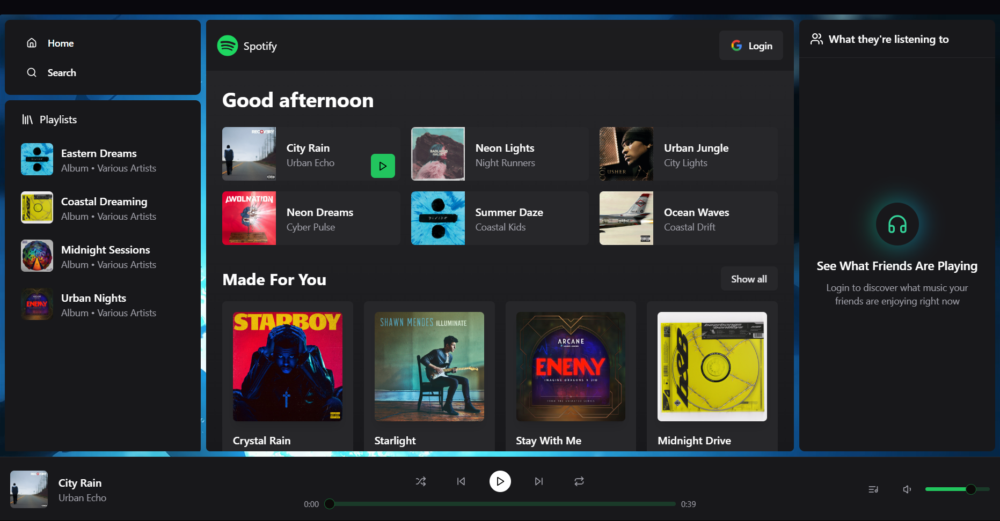
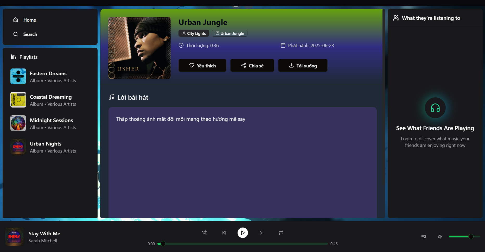
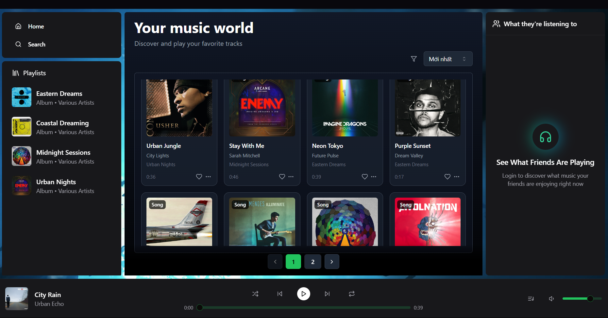
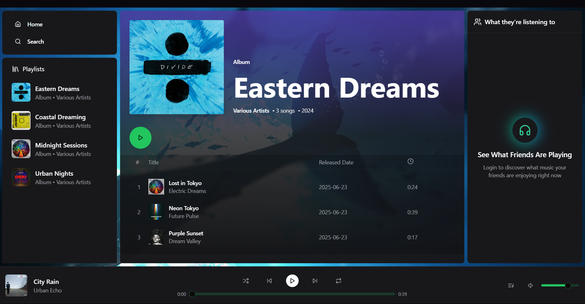
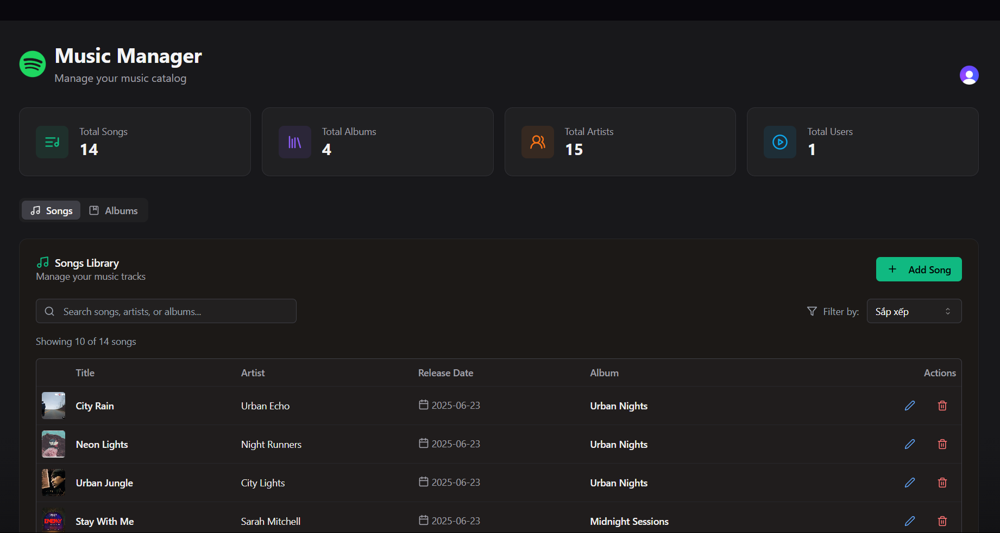
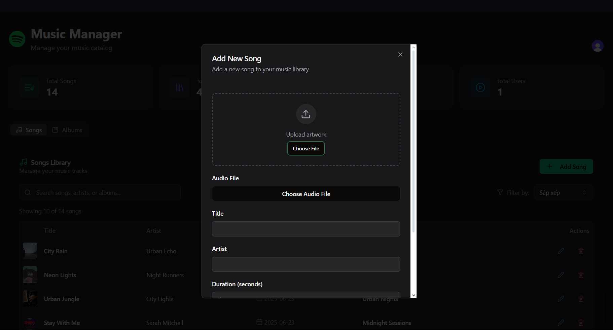

# 🎵 MusicHub — Website Âm Nhạc Trực Tuyến

MusicHub là một nền tảng nghe nhạc trực tuyến hiện đại, tích hợp nhiều tính năng thông minh giúp người dùng trải nghiệm âm nhạc mượt mà và tương tác trực tiếp với cộng đồng yêu nhạc.

## 🚀 Tính Năng Chính

- **Trang chủ (Homepage)**  
  Hiển thị các album, bài hát nổi bật và gợi ý cá nhân hóa.

- **Tìm kiếm toàn văn (Full-text Search) với MongoDB Atlas**  
  Tìm kiếm nhanh chóng và chính xác theo tên bài hát, album, ca sĩ.

- **Nghe nhạc trực tuyến**  
  Trình phát nhạc tích hợp ngay trên web, hỗ trợ phát liên tục và playlist.

- **Trò chuyện văn bản (Chat) trực tuyến**  
  Giao tiếp với bạn bè hoặc cộng đồng khi đang nghe nhạc.

- **Hiển thị trạng thái người dùng**  
  - Ai đang **online**  
  - Ai đang **nghe bài gì**

- **Chức năng quản trị (Admin)**  
  - Thêm / sửa / xóa **album**  
  - Thêm / sửa / xóa **bài hát**  

## 🛠️ Công Nghệ Sử Dụng

- **Frontend**: ReactJS, Vite, Tailwindcss, ShacnUI
- **Backend**: Node.js + Express.js
- **Cơ sở dữ liệu**: MongoDB Atlas 
- **Realtime**: Socket.IO 
- **Trình phát nhạc**: HTML5 Audio API

## 📦 Cài Đặt & Chạy Dự Án

### 1. Clone repository
```shell
git clone https://github.com/DannyCandy/WebsiteMusic.git
cd WebsiteMusic
```

### 2. Thiết lập file .env trong folder backend
```bash
PORT=...
MONGODB_URI=...
NODE_ENV=...

CLOUDINARY_API_KEY=...
CLOUDINARY_API_SECRET=...
CLOUDINARY_CLOUD_NAME=...

CLERK_PUBLISHABLE_KEY=...
CLERK_SECRET_KEY=...
```

### 3. Thiết lập file .env.local trong folder frontend
```bash
VITE_CLERK_PUBLISHABLE_KEY=...
CLERK_SIGN_IN_URL =...
```

### 4. Di chuyển vào folder dự án vừa clone về, tại folder backend thực hiện
```bash
npm i
npm run dev
```

### 5. Di chuyển vào folder dự án vừa clone về, tại folder frontend thực hiện
```bash
npm i
npm run dev
```
Truy cập http://localhost:3000

## 📸 Ảnh Demo

### 1. Giao diện trang chủ



### 2. Giao diện chi tiết bài hát



### 3. Giao diện hiển thị tất cả bài hát



### 4. Giao diện chi tiết album



### 5. Giao diện trang quản trị



### 6. Giao diện thêm mới bài hát


<br>

**Happy coding!** :heart: